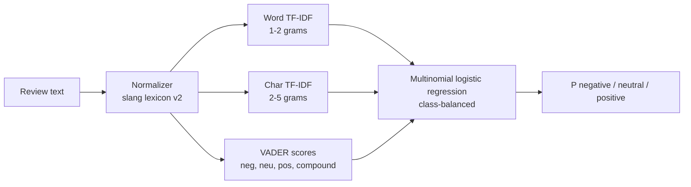

# E-commerce Product Review Sentiment Analysis

Classifies customer reviews as **positive / negative / neutral**, stores them per product, and shows each product's sentiment distribution plus a buying recommendation. The system is built for the informal language of real e-commerce reviews: slang, misspellings, Hinglish, and emoji.

The project has two versions:

| | v1 (original release) | v2 (current) |
|---|---|---|
| Classifier | VADER lexicon rules | Trained hybrid model: word + character TF-IDF + VADER features → logistic regression |
| Informal language | 227-entry slang/abbreviation dictionary | Dictionary audited and extended with e-commerce and Hinglish terms mined from training data |
| Evaluation | Manual testing | 3 public test sets, 13 configurations, paired-bootstrap significance tests |
| Recommendation | `text-davinci-003` prompt | Deterministic summary from the sentiment distribution and frequent terms |
| Storage | AWS API Gateway → Lambda → DynamoDB | Same, plus a local JSON backend for offline demos |

## 1. v1 architecture

**Web app.** Flask with Jinja templates. A user picks a product category and submits a review. The review is classified and sent to a REST endpoint on AWS API Gateway (`POST /review` with `product_id`, `review`, `sentiment`), backed by AWS Lambda and DynamoDB. `GET /review?product_id=…` returns a product's reviews for the analysis page.

**Sentiment pipeline** (reproduced exactly in `src/legacy/pipeline_v1.py`):

1. Lowercase the text.
2. Replace slang and abbreviations using `data/slangWords.json`.
3. Convert emoji to text (`demoji`).
4. Score with VADER (Hutto & Gilbert, 2014): compound ≥ 0.05 is positive, ≤ −0.05 is negative, otherwise neutral.
5. Ask `text-davinci-003` for a label. If the reply parsed as Positive, Negative or Neutral, it replaced VADER's label.

**Motivation for the slang module.** During development we saw VADER mislabel reviews written in informal language. VADER's lexicon has no entry for abbreviations like "gr8", "idk" or "ngl", so those tokens contribute nothing to the score.

## 2. v2: what changed and why

### 2.1 Audit of the v1 slang dictionary

Re-reading the v1 dictionary against real product reviews found several problems:

- **Wrong-domain mappings.** "nyc" became "new york city", but in Indian-English reviews it nearly always means "nice". "hp" became "horsepower" (HP is a laptop brand), "pm" became "prime minister", and "ms" became "miss".
- **Matching bug.** Keys that begin or end with punctuation ("$", "c/o", "tl;dr") never matched, because `\b` requires a word character.
- **Lost emphasis.** Lowercasing first threw away the ALL-CAPS cue that VADER uses to boost intensity.

### 2.2 New normalizer (`src/nlp/normalize.py`, `data/slang_ecommerce_extension.json`)

- The original list is kept unchanged (v1). The v2 lexicon applies the fixes above and adds about 70 terms.
- New terms were found by mining frequent out-of-vocabulary tokens from the **training splits only**, then manually mapping the unambiguous ones. They fall into three groups:
  - **Hinglish:** bakwas → rubbish, bekar → useless, kharab → defective, accha → good, nahi → not, paisa wasool → worth the money.
  - **Misspellings:** wrost → worst, awsm → awesome, bettery → battery.
  - **Informal forms:** gud, bcz, pls, luv.
- All replacements happen in one pre-compiled regex. Matches are case-insensitive, and ALL-CAPS slang stays capitalized ("AWSM" → "AWESOME").
- Optional stages handle elongations ("goooood" → "good") and emoji descriptions.

### 2.3 New classifier (`src/nlp/model.py`)



- **Word n-grams** learn domain phrases such as "heating issue", "not worth" and "value for money".
- **Character n-grams** make the model robust to misspellings it has never seen.
- **VADER's four scores** give it a lexicon prior, which helps where training data is thin (see the Amazon result in §3).
- **Training data:** TweetEval train (45.6k informal tweets, 3-class) plus K8 train (9.1k Amazon India phone reviews, binary).
- **Model selection:** the regularization strength C and the production configuration were chosen on the validation splits only.

## 3. Evaluation (`scripts/evaluate.py`; full output in `reports/RESULTS.md`)

**Test sets** (none used for training or tuning):

- **TweetEval:** 12,284 tweets, 3-class.
- **K8:** 2,594 Amazon India phone reviews, binary.
- **Amazon memory-card reviews:** 4,914 reviews, 3-class from star ratings. This dataset is entirely unseen, so it measures out-of-domain performance.

"Slang subset" means test items containing at least one lexicon term (973, 355 and 435 items respectively).

**Macro-F1:**

| System | TweetEval | K8 | Amazon (out-of-domain) |
|---|---|---|---|
| v1 pipeline  | 0.527 | 0.707 | **0.415** |
| VADER, no slang handling | 0.526 | 0.707 | 0.415 |
| TF-IDF + logistic regression | 0.613 | 0.871 | 0.322 |
| **Hybrid (production)** | **0.617** | **0.872** | 0.355 |

### Findings

1. **The trained model beats the v1 system in-domain, with significant gains** (paired bootstrap, 2,000 resamples):
   - TweetEval: +0.090 macro-F1 (95% CI +0.082 to +0.099).
   - K8 phone reviews: +0.165 (CI +0.146 to +0.184).
   - The gain is larger still on slang-containing reviews: +0.223 on the K8 slang subset.
2. **It is worse out-of-domain:** −0.060 on Amazon memory-card reviews. It labels many positive accessory reviews as negative, a classic domain-shift failure. VADER's rules don't depend on training data, so they transfer better. Adding the VADER features recovers part of the gap (+0.033, p < 0.001), which is why the production model is the hybrid.
3. **The slang dictionary's effect is small, and the evaluation shows exactly where it helps:**
   - The v1 list had no measurable effect on any test set, for VADER or for the trained models. Most of its entries are chat abbreviations ("brb", "afk") that rarely carry sentiment.
   - The extended lexicon helps on informal Indian e-commerce reviews: about +0.02 macro-F1 on the K8 slang subset, for both VADER and the trained models (p ≈ 0.04–0.07, borderline significance).
   - On tweets it slightly hurts the trained models (−0.031 on the TweetEval slang subset).
   - Character n-grams already learn most misspellings from data, which leaves little for a lookup table to add.
   - Conclusion: lexicon normalization is worth it when labeled in-domain data is scarce. Once you have training data, learned subword features cover most of it.

Reviews the extended lexicon fixed include "Gud but slightly heats up", "Gd product in low price", and the fully Hinglish "Yeh mujhe use karte 1 month hogaya hai aur yeh kafi acha perform kar raha hai" (all now correctly positive).

### Limitations

- K8 labels are binary, so neutral performance is measured only on TweetEval and Amazon.
- The memory-card set's labels come from star ratings, which are noisy.
- A transformer baseline (e.g. a RoBERTa sentiment model) was not run here and is the obvious next comparison.
- Domain adaptation (adding product-review training data from more categories) is the clearest fix for finding 2.

## 4. Running it

```bash
pip install -r requirements.txt
python scripts/setup_nltk.py           # VADER lexicon + word list
python scripts/download_data.py        # public datasets -> data/processed/
python scripts/evaluate.py             # ~20 min on CPU; writes reports/ and models/
python scripts/predict.py "nyc phn, paisa wasool!!"
python app.py                          # http://127.0.0.1:5000
```

`models/sentiment_model.joblib` is committed, so the app and `predict.py` work without retraining (step 3 and 4 are only needed to reproduce the results).

Environment variables:

- `STORAGE_BACKEND`: `local` (default) or `aws`.
- `REVIEW_API_URL`: the API Gateway endpoint, used when the backend is `aws`.
- `FLASK_SECRET_KEY`: the Flask session secret.
- `FLASK_DEBUG=1`: turns on debug mode.

## 5. Structure

```
app.py                         Flask routes
src/nlp/normalize.py           slang / elongation / emoji normalizer
src/nlp/model.py               hybrid classifier definition
src/functions/sentiment.py     inference used by the app
src/functions/summary.py       distribution + recommendation text
src/api/                       AWS API Gateway client + storage abstraction
src/legacy/pipeline_v1.py      exact v1 pipeline, kept as a baseline
data/slangWords.json           v1 slang dictionary (unchanged)
data/slang_ecommerce_extension.json   v2 additions and corrections
scripts/                       data download, evaluation, CLI demo
reports/                       RESULTS.md, results.json, confusion matrices
```

## Datasets

- **TweetEval:** Barbieri et al., 2020, from SemEval-2017 Task 4. https://github.com/cardiffnlp/tweeteval
- **Lenovo K8 Note Amazon.in reviews:** mirrored at https://github.com/kameshwaran1995/Topic-Analysis-of-Review-Data
- **Amazon memory-card reviews:** mirrored at https://github.com/AnayDubey/Amazon-Product-Reviews-Sentiment-Analysis
